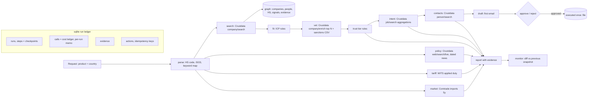

# TradeScout architecture

- Every box with an external call goes through `ctx.call`, which checks the time and credit ceiling, memoises identical calls inside a run, and writes a ledger row with credits and latency.
- Every step commits its output as a checkpoint; `resume <run-id>` continues from the first unfinished step.
- Actions move proposed → approved → executing → executed; the approved → executing transition is a guarded UPDATE, so a restart cannot execute an action twice.
- Layers marked optional (market, tariff, policy, intent, monitor) report `unavailable` with a reason instead of failing the run.
