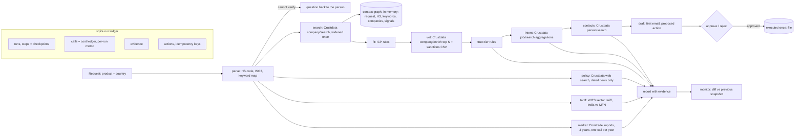

# TradeScout architecture

- Every box with an external call goes through `ctx.call`, which checks the time and credit ceiling, memoises identical calls inside a run, and writes a ledger row with credits and latency.
- Every step commits its output as a checkpoint; `resume <run-id>` continues from the first unfinished step.
- Actions move proposed → approved → executing → executed; the approved → executing transition is a guarded UPDATE, so a restart cannot execute an action twice.
- Layers marked optional (market, tariff, policy, intent, contacts, monitor) report `unavailable` or `cannot_verify` with a reason instead of failing the run.
- Retries: 429 waits for `x-ratelimit-reset`; 5xx backs off; 4xx is final. Comtrade is paced at one call per 2.2 s. A source that times out leaves its layer unavailable; it never reads as an answer.
- Where state lives: `data/tradescout.db` (runs, steps, calls, evidence, actions, snapshots) and `data/out/` (approved drafts). The in-process event bus feeds SSE; the ledger is the truth after a restart.
- Personal data: name, title and employer only, from person search; no contact enrichment; drafts never leave the machine.
